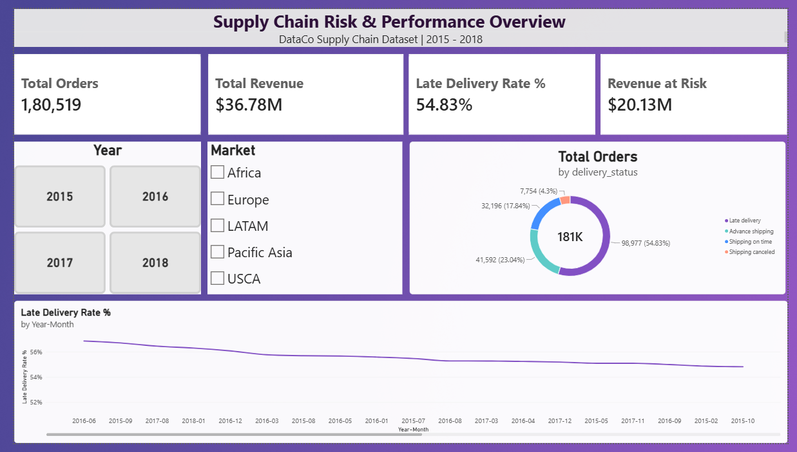
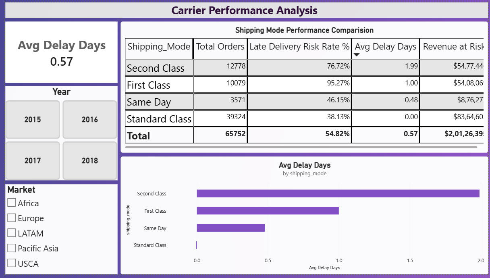
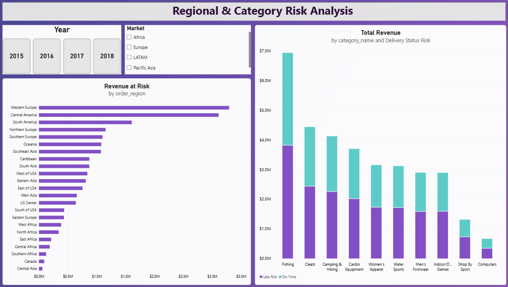

# End-to-End Supply Chain Risk & Performance Analytics Dashboard

## Executive Summary

This project analyses the DataCo supply chain dataset to evaluate order performance, delivery risk, carrier performance, and regional operational patterns.

An end-to-end analytics workflow was developed using **Python, Pandas, PostgreSQL, SQL, and Power BI** to clean, validate, analyse, and visualize supply chain data.

The final Power BI dashboard contains three interactive pages, providing insights into overall supply chain performance, carrier efficiency, and regional and category-level risk.

## Key Performance Indicators

| KPI | Value |
|---|---:|
| Total Orders | 65,752 |
| Total Revenue | $36.79M |
| Late Delivery Risk Rate | 54.82% |
| Revenue at Risk | $20.13M |

**Note:** Late Delivery Risk Rate represents the percentage of distinct orders flagged with a late-delivery risk indicator in the dataset. Revenue at Risk represents revenue associated with those flagged orders; it does not represent confirmed financial loss.

## Tools & Technologies

- **Python:** Data cleaning, preprocessing, validation, and exploratory data analysis.
- **Pandas:** Data manipulation and transformation.
- **PostgreSQL:** Data storage, SQL analysis, and KPI validation.
- **SQL:** Aggregations, filtering, and operational performance analysis.
- **Power BI:** Interactive dashboard development and visualization.
- **DAX:** KPI calculations and risk metrics.
- **Data Modelling:** Star schema with a dedicated date table.

## Project Workflow

### 1. Data Cleaning & Preparation — Python

- Loaded and explored the raw supply chain dataset using Pandas.
- Handled missing values and checked data quality.
- Validated records and examined relevant date and delivery fields.
- Prepared a standardized cleaned dataset for further analysis.

### 2. SQL Analysis — PostgreSQL

- Imported the cleaned dataset into PostgreSQL.
- Used SQL queries to analyse order performance and delivery patterns.
- Calculated baseline KPIs and examined carrier and regional performance.
- Cross-validated key figures before dashboard development.

### 3. Data Modelling & Dashboard Development — Power BI

- Imported the cleaned dataset into Power BI.
- Designed a star-schema data model with a dedicated date table.
- Established one-to-many relationships with single-direction filtering.
- Created DAX measures to calculate order volume, revenue, delivery risk, and revenue exposure.
- Developed a three-page interactive dashboard.

## Key DAX Measures

**Total Orders**
```dax
Total Orders =
DISTINCTCOUNT(cleaned_supply_chain[order_id])
```

**Total Revenue**
```dax
Total Revenue =
SUM(cleaned_supply_chain[sales])
```

**Late Delivery Risk Rate**
```dax
Late Delivery Risk Rate % =
DIVIDE(
    CALCULATE(
        [Total Orders],
        cleaned_supply_chain[late_delivery_risk] = 1
    ),
    [Total Orders],
    0
)
```

**Revenue at Risk**
```dax
Revenue at Risk =
CALCULATE(
    [Total Revenue],
    cleaned_supply_chain[late_delivery_risk] = 1
)
```

## Dashboard Pages

### Page 1 — Supply Chain Risk & Performance Overview

Provides a high-level view of supply chain performance through key KPIs, order trends, revenue, and delivery risk indicators.

### Page 2 — Carrier Performance Analysis

Examines carrier performance and compares delivery risk across shipping modes to identify areas requiring operational attention.

### Page 3 — Regional & Category Risk Analysis

Explores regional and product-category patterns to highlight variations in supply chain performance and revenue exposure.

## Dashboard Screenshots

### Executive Overview

[View Executive Overview image](Executive Overview.png)

### Carrier Performance

[View Carrier Performance image](Carrier Performance.png)

### Regional & Category Risk

[View Regional and Category Risk image](Regional and Category Risk.png)

## Key Project Outcomes

- Built an end-to-end analytics workflow integrating Python, PostgreSQL, SQL, and Power BI.
- Identified that 54.82% of distinct orders were flagged with late-delivery risk.
- Quantified approximately $20.13M in revenue associated with risk-flagged orders.
- Developed an interactive dashboard to monitor supply chain performance across carriers, shipping modes, regions, and product categories.

## Business Objective

The objective of this project is to demonstrate how data analytics can support supply chain monitoring, identify potential delivery risks, evaluate operational performance, and provide actionable visibility for business decision-making.
